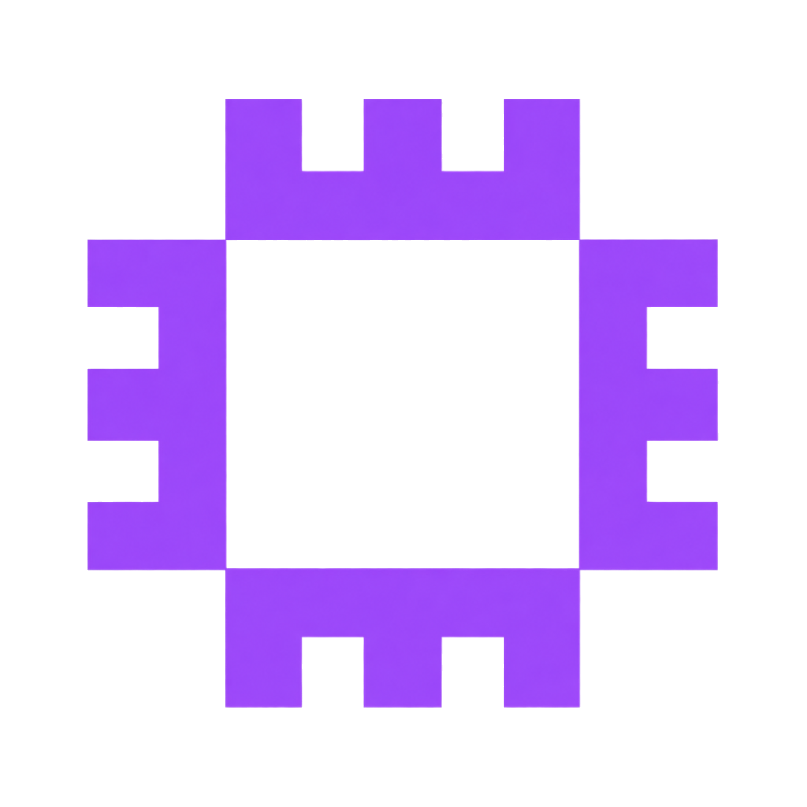

<!--
  =============================================================================
  AWS Student Builders Group LPU - GitHub Organization Profile README
  =============================================================================
  GitHub displays this README on your organization profile page:
  https://github.com/awsbuilderslpu
  =============================================================================
-->

<div align="center">

  

  # ☁️ AWS Student Builders Group — LPU
  ### *A Stronger Cloud Community Together.*

  <p align="center">
    <b>Empowering students at Lovely Professional University to design, build, and deploy production-ready cloud architectures.</b>
  </p>

  <p align="center">
    <a href="https://awslpu.in"></a>
    <a href="https://www.linkedin.com/company/awsbuilderslpu"></a>
    <a href="https://discord.com/channels/1093195608409510009/1204396903605993472"></a>
    <a href="https://www.instagram.com/awsbuilders.lpu/"></a>
    <a href="https://www.youtube.com/@AWSCloudCommunityLPU"></a>
  </p>

  <p align="center">
    
    
    
    
  </p>

</div>

---

### 🌟 About Us

**AWS Student Builders Group LPU** is the official student-driven cloud computing community at **Lovely Professional University (LPU)**, Punjab, India. 

We bridge the gap between classroom theory and real-world distributed systems. From hosting intensive hands-on architecture bootcamps and certification study cohorts to launching live production applications and hackathons, our community is dedicated to cultivating the next generation of cloud architects, DevOps engineers, and AI innovators.

> *"If you can run it locally, you can scale it globally on AWS."*

---

### 📊 Community Impact at a Glance

<div align="center">

| 👥 **2,000+** | 🛠️ **25+** | 🚀 **50+** | 🎓 **100%** |
| :---: | :---: | :---: | :---: |
| **Students Impacted**<br/>across campus sessions & bootcamps | **Hands-on Workshops**<br/>covering AWS, DevOps & AI | **Cloud Projects Built**<br/>deployed live on cloud infrastructure | **Student-Led & Open**<br/>peer mentorship for all skill levels |

</div>

---

### 🎯 Core Domains & Focus Areas

```
                             ┌───────────────────────────────────────┐
                             │    AWS Student Builders Group LPU     │
                             └───────────────────┬───────────────────┘
                                                 │
         ┌───────────────────┬───────────────────┼───────────────────┬───────────────────┐
         ▼                   ▼                   ▼                   ▼                   ▼
   ┌───────────┐       ┌───────────┐       ┌───────────┐       ┌───────────┐       ┌───────────┐
   │Serverless │       │ DevOps &  │       │ Cloud AI  │       │  Security │       │Cert Cohort│
   │& Event-   │       │IaC (CDK & │       │& Bedrock/ │       │ & Arch    │       │& Career   │
   │Driven Apps│       │Terraform) │       │SageMaker  │       │Governance │       │Roadmaps   │
   └───────────┘       └───────────┘       └───────────┘       └───────────┘       └───────────┘
```

- ⚡ **Serverless & Microservices**: Architecting event-driven, cost-effective backends using AWS Lambda, API Gateway, DynamoDB, EventBridge, and SQS/SNS.
- 🔄 **DevOps, Containers & IaC**: Declarative infrastructure using AWS CDK, Terraform, CloudFormation, Docker, and Amazon ECS/EKS with automated GitHub Actions CI/CD.
- 🧠 **Cloud AI & Generative Intelligence**: Building intelligent agents and RAG applications with Amazon Bedrock, SageMaker, and OpenSearch.
- 🛡️ **Cloud Security, IAM & Resilience**: Applying the AWS Well-Architected Framework, least-privilege IAM policies, Zero Trust, and VPC networking.
- 📜 **Certification & Career Acceleration**: Structured mentorship roadmaps for AWS Certified Cloud Practitioner (CCP) and Solutions Architect – Associate (SAA).

---

### 🛠️ Technologies & Cloud Ecosystem

<p align="center">
  <!-- Cloud & Services -->
  
  
  
  
  
  
  
  <br/>
  <!-- Development & Full Stack -->
  
  
  
  
  
  
  
</p>

---

### 💡 Flagship Initiatives

- 🌐 **[awslpu.in](https://awslpu.in)**: The student community portal featuring event registrations, club blogs, open project repositories, member directories, and interactive certification guides.
- 🧪 **Hands-on Cloud Labs**: Monthly code-along sessions where students deploy serverless web apps, containerized services, and automated CI/CD pipelines.
- 🏆 **Hackathons & AWS Jam**: University-wide competitive problem-solving sessions resolving real architectural challenges and business use cases.
- 🎓 **Cloud Certification Accelerator**: Study groups and peer review sessions for industry certifications with mock exam walkthroughs.

---

### 🧭 The Builder Creed

1. **If you can run it locally, you can scale it globally on AWS.**
2. **Architecture is not an afterthought; it is our foundation.**
3. **Learn by deploying: fail in dev, test rigorously, excel in prod.**
4. **Never build in isolation — true builders grow together.**

---

### 🤝 Join & Contribute

We welcome students, cloud enthusiasts, open-source contributors, and mentors!

- 💻 **Star & Contribute**: Explore our public repositories, check open issues, and submit Pull Requests.
- 🗣️ **Speak & Mentor**: Are you an AWS Community Builder, Hero, or cloud professional? We'd love to host you for a technical talk or masterclass.
- 🎒 **Join the Club**: If you are an LPU student, join our Discord, attend our weekly syncs, and apply during recruitment drives.

Check out our contribution guidelines in our active repositories or reach out directly via [awsbuilders.lpu@gmail.com](mailto:awsbuilders.lpu@gmail.com).

---

### 📬 Connect With Us

<div align="center">

| Platform | Link | Description |
| :--- | :--- | :--- |
| 🌐 **Website** | [awslpu.in](https://awslpu.in) | Official web portal, blogs & events |
| 💼 **LinkedIn** | [AWS Builders LPU](https://www.linkedin.com/company/awsbuilderslpu) | Professional updates & event recaps |
| 💬 **Discord** | [AWS Student Builders Community](https://discord.com/channels/1093195608409510009/1204396903605993472) | Daily chats, queries & study rooms |
| 📷 **Instagram** | [@awsbuilders.lpu](https://www.instagram.com/awsbuilders.lpu/) | Stories, event highlights & announcements |
| ▶️ **YouTube** | [@AWSCloudCommunityLPU](https://www.youtube.com/@AWSCloudCommunityLPU) | Recorded sessions, workshops & demos |
| 📧 **Email** | [awsbuilders.lpu@gmail.com](mailto:awsbuilders.lpu@gmail.com) | Collaboration, inquiries & sponsorships |

</div>

<br/>

<div align="center">
  <sub>Built with ❤️ by the students of <b>AWS Student Builders Group LPU</b> • Lovely Professional University, India</sub>
</div>

